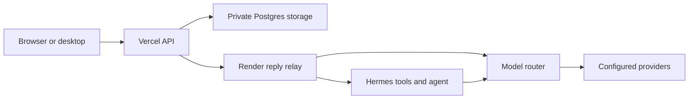

# Vaelo

A private assistant for questions, files, research, and saved work, available on the web and desktop.

[Open Vaelo](https://vaelochat.vercel.app) · [Desktop downloads](https://vaelochat.vercel.app/download)

## Quick start

Use Node.js 24. From the repository root:

```sh
cd web
npm ci
npm run dev
```

Copy `web/.env.example` into `web/.env.local` to configure Google sign-in, the relay and private Postgres storage. Local frontend development does not require provider calls. For a local cloud relay, provider setup and deployment, see [deployment details](docs/deployment-details.md) and [web hosting](web/DEPLOYMENT.md).



The relay streams numbered events so disconnected clients can resume. Optional shared run storage preserves accepted events across relay restarts. The relay admits two concurrent runs in the supplied Render configuration.

## Development

```sh
cd web
npm test
npm run lint
npm run build
npm run check:bundle
```

Python checks: `python -m unittest discover -s tests -v`. Native setup and signing are covered in the [desktop guide](web/desktop/README.md). Browser checks run against a local preview with mocked APIs.

[Audit implementation status](docs/audit-implementation-2026-11-13.md) lists completed changes, verification and remaining deployment or evaluation requirements. [Capability notes](docs/capabilities-release.md) explain memory, privacy and evaluation limits.
